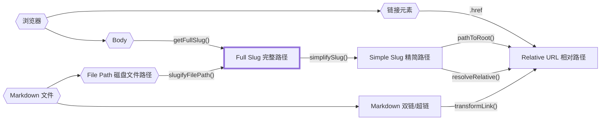

路径系统的逻辑往往相当复杂，特别是对于静态站点生成器而言，路径可能来自多种不同的上下文环境：

某个文章在磁盘上的物理绝对路径是一种路径；文章在 URL 中的 Slug 路由也是一种路径；相对引用链接又是另一种路径。

如果将它们全部简单地声明为 `string` 字符串类型，开发中极易不小心混淆不同种类的路径。不幸的是，TypeScript 默认并不具备[标称类型系统（Nominal Type System）](https://en.wikipedia.org/wiki/Nominal_type_system)，这意味着即使你为服务端 Slug 或客户端 Slug 创建了类型别名，你依然可以把其中一个赋给另一个，而 TypeScript 编译器并不会报错。

幸运的是，在 TypeScript 中我们可以通过**类型品牌化（Branded Types）**来模拟标称类型：

```typescript
// 我们不再这样做：
type FullSlug = string

// 而是这样做：
type FullSlug = string & { __brand: "full" }

// 这样一来，直接赋予未经转换的普通字符串将会触发类型检查报错：
const slug: FullSlug = "some random string" // ❌ 类型错误！
```

虽然这有效防止了在我们类型系统内部将一种路径类型误当做另一种，但在将外部原始字符串通过强制类型转换转换为这些标称类型时（即入口点处），仍需十分谨慎。

下图展示了所有路径来源、标称路径类型以及 `quartz/path.ts` 中用于在它们之间进行安全转换的核心函数关系：



以下是 Quartz 中核心 Slug/路径类型的详细定义与规范：

- `FilePath`：磁盘上文件的实际真实物理路径。不能是相对路径，且必须带有文件扩展名。
- `FullSlug`：全量规范 Slug。不能是相对路径，前后不能带有斜杠 `/`。它可以以 `index` 作为其最后一段。这是最通用且标准的 Slug 内部表示，推荐在核心处理流水线中优先使用。
- `SimpleSlug`：精简展示 Slug。不能是相对路径，末尾不应该带有 `/index` 或文件扩展名。但它*可以*包含尾部斜杠以表示文件夹目录路径。
- `RelativeURL`：相对 URL 地址。必须以 `.` 或 `..` 开头以明确表示其为相对链接。末尾不包含 `/index` 或文件扩展名，但可带有尾随斜杠。

如需更深入地理解它们之间的转换细节与边界条件，可查阅 `quartz/util/path.test.ts` 中的单元测试用例。
