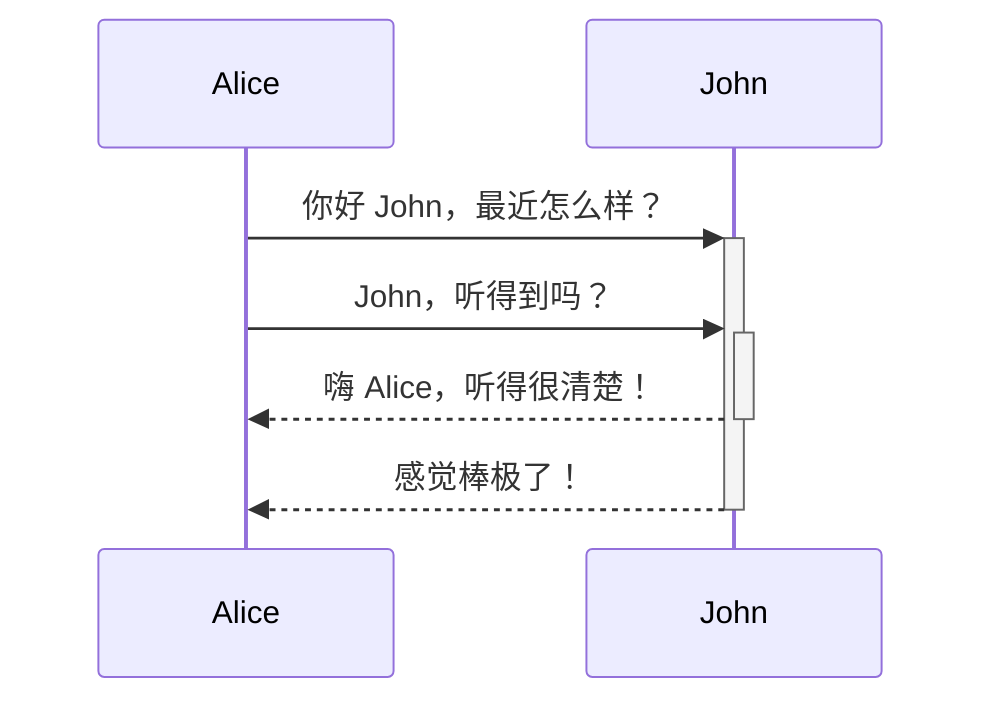

Quartz 支持 [Mermaid](https://mermaid.js.org/)，允许你直接在 Markdown 笔记中绘制丰富的图表和流程图。Mermaid 支持多种图表类型，例如[流程图（Flowcharts）](https://mermaid.js.org/syntax/flowchart.html)、[时序图（Sequence Diagrams）](https://mermaid.js.org/syntax/sequenceDiagram.html)、类图、甘特图以及[时间线（Timelines）](https://mermaid.js.org/syntax/timeline.html)。该功能作为 [[Obsidian compatibility|Obsidian 兼容特性]] 的一部分提供，可在对应插件中配置启用或禁用。

默认情况下，Quartz 会自动调整 Mermaid 图表的配色方案以匹配站点的浅色/深色主题。

> [!warning] 插件顺序提醒
> 如果已启用 Mermaid 却未正常显示图表？你可能需要调整插件执行顺序，确保 [[ObsidianFlavoredMarkdown]] 位于 [[SyntaxHighlighting]] *之后*。

## 语法

使用 `mermaid` 语言标识的代码块即可插入 Mermaid 图表：

````markdown

````


