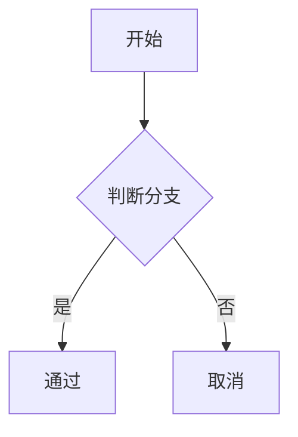

Quartz 最初的设计初衷，便是将 Obsidian 知识库直接发布为功能完整的独立网站。即使随着时间的演进 Quartz 的定位不断延伸，它与 Obsidian 之间的无缝互操作性依然是其最坚固的基石。

默认情况下，Quartz 附带了 [[ObsidianFlavoredMarkdown]] 转换器插件，添加了对 [Obsidian 特色 Markdown（OFM）](https://help.obsidian.md/Editing+and+formatting/Obsidian+Flavored+Markdown) 语法的原生支持，包括 [[wikilinks|双向链接]] 和 [[Mermaid diagrams|Mermaid 图表]]。

它还通过 [[Frontmatter]] 转换器插件提供了对 [Obsidian 属性面板（Properties / Frontmatter）](https://help.obsidian.md/Editing+and+formatting/Properties) 的完全兼容解析。

此外，Quartz 还提供了 [[CrawlLinks]] 插件，允许你自定义链接解析规则，与 Obsidian 的短路径或绝对路径解析习惯保持严密一致。

## 支持的核心语法特性

### 双向链接（Wikilinks）

使用 `[[页面]]` 语法的内部链接会自动转为标准超链接。完整支持以下所有用法变体：

```markdown
[[页面]]                         链接到对应页面
[[页面|自定义显示名]]             带别名的显示链接
[[页面#小标题]]                  链接到目标页面中的小标题
[[页面#小标题|自定义显示名]]       链接到小标题并覆盖显示文本
[[页面#^块ID]]                   链接到特定的块引用
![[页面]]                        嵌入并展示完整页面内容
![[图片.png]]                    嵌入并展示图片附件
![[图片.png|描述 100x200]]        嵌入图片并指定替代文本与尺寸
```

在表格内部，双链中的管道符 `|` 可以使用反斜杠转义：`[[页面\|别名]]`。

### 高亮标记（Highlights）

使用两对等号 `==` 包裹文本即可实现荧光高亮效果：

```markdown
这是句子中的 ==高亮荧光文字==。
```

渲染效果为：这是句子中的 ==高亮荧光文字==。

### 隐藏注释（Comments）

Obsidian 风格的 `%%` 语法注释会在输出时自动剔除，不会泄露到公开网页中：

```markdown
这是公开可见的正文。%%这是内部草稿注释，网页上不会显示。%%
```

渲染效果为：这是公开可见的正文。%%这是内部草稿注释，网页上不会显示。%%

同样支持多行注释块：

```markdown
%%
这一整块多行文字
全都是内部隐藏注释。
%%
```

### 标签（Tags）

正文中以 `#` 开头的标签会被自动解析并生成专属的标签归档链接：

```markdown
#tag #嵌套标签/子标签 #带连字符标签
```

例如：#feature/transformer

> [!note] 纯数字忽略
> 类似于 `#123` 这样的纯数字标签会被自动忽略，遵循 Obsidian 的规范。

### 标注块（Callouts）

完整支持 [[callouts|Obsidian Callouts 标注块]]，包括默认折叠/展开的交互特性：

```markdown
> [!note]
> 这是一个普通笔记标注。

> [!warning]- 默认折叠
> 这部分内容初始状态下会被折叠隐藏。

> [!tip]+ 默认展开
> 这部分内容初始状态下可见。
```

> [!example] 示例
> 这是一个基于 Obsidian-Flavored Markdown 实时渲染的标注块。

所有内置标注类型均获支持：`note`、`abstract`、`info`、`todo`、`tip`、`success`、`question`、`warning`、`failure`、`danger`、`bug`、`example` 以及 `quote` 及其全套别名。

### 任务待办列表与自定义任务标记字符

标准任务复选框开箱即用。若开启 `enableCheckbox: true`，还支持 Obsidian 社区广泛流行的扩展任务字符：

```markdown
- [ ] 未完成待办
- [x] 已完成任务
- [?] 疑问待确认
- [!] 紧急重要
- [>] 已顺延交接
- [/] 正在进行中
- [-] 已取消废除
- [s] 特殊星标
```

每个自定义任务字符都会在渲染出的 HTML 元素上保留对应的 `data-task` 属性，方便通过 CSS 自定义渲染不同形态的复选框图标。

- [ ] 未完成待办
- [x] 已完成任务
- [?] 疑问待确认
- [!] 紧急重要

### Mermaid 流程图与图表

[[Mermaid diagrams|Mermaid]] 代码块会被自动渲染为美观的矢量图表：

````markdown

````


### 视频嵌入（YouTube）

使用标准图片语法并填入 YouTube 视频链接即可自动嵌入播放器：

```markdown


```

### 社交卡片嵌入（X / Twitter）

使用标准图片语法填入 Twitter/X 链接会被渲染为静态卡片并链接至原帖：

```markdown

```

### 块引用（Block References）

块引用支持精确定位和跨页面链接到段落块：

```markdown
正文段落。 ^my-block

[[Page#^my-block]]
```

### Obsidian URI 协议链接

使用 `obsidian://` 协议的链接会自动标注 `obsidian-uri` CSS 类与 `data-obsidian-uri` 属性，以便在前端赋予其特殊的快捷打开 Obsidian 按钮外观。

### 视频文件嵌入

本地或远端视频文件可使用标准语法嵌入：

```markdown


```

### HTML 内部语法解析（Embed in HTML）

默认情况下 Obsidian 不会解析原生 HTML 标签内部的 Markdown。Quartz 通过 `enableInHtmlEmbed` 选项对此进行了扩展，支持在原生 HTML 节点内部解析双链、高亮和标签。

### 脚注（Footnotes）

通过 [[GitHubFlavoredMarkdown]] 插件完整支持 `[^1]` 脚注语法：

```markdown
这是一句包含脚注的文本。[^1]

[^1]: 这里是对应的脚注内容。
```

## Obsidian 社区插件兼容

Quartz 核心聚焦于对 Obsidian 原生核心特性的极致还原。对于 Obsidian 社区热门插件的功能，由对应的 Quartz 社区插件提供支持：

| Obsidian 插件 | Quartz 支持方式 |
| --------------- | ------------------------------------------------------------------------------------------------------------------------------------------- |
| Dataview        | 通过 [Quartz Syncer](https://community.obsidian.md/plugins/quartz-syncer) 同步插件支持——在同步时将 Dataview 查询直接导出为静态内容 |
| Excalidraw 手绘白板 | 通过 `obsidian-plugin-excalidraw` 社区插件支持 |
| Leaflet 地图    | 通过 `obsidian-plugin-leaflet` 社区插件支持 |
| Style Settings 样式调校 | 通过 `quartz-themes` 社区插件支持 |

> [!tip] 规律法则
> 总体规律是：Obsidian 核心功能由 Quartz 原生支持；Obsidian 社区第三方插件功能由对应的 Quartz 社区插件支持。

## 驱动插件

这些功能主要由 [[ObsidianFlavoredMarkdown]]、[[Frontmatter]] 以及 [[CrawlLinks]] 插件协同提供。详细自定义选项请参阅各插件专属页面。
